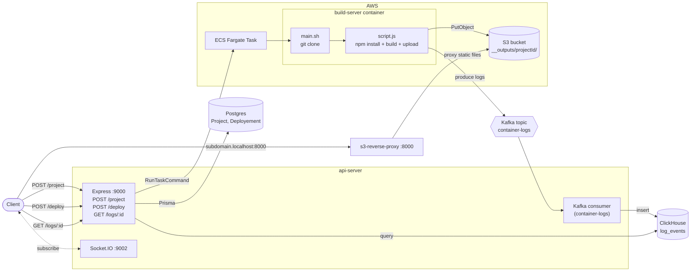

# deployement

A minimal Vercel-style deployment platform. You register a Git repository as a project and trigger a deployment. The repo is cloned and built in an isolated container on AWS ECS Fargate, and the build output is uploaded to S3 and served through a reverse proxy. Build logs go through Kafka into ClickHouse, and you can query them over HTTP.

## Architecture



## Flow

1. **Create project:** `POST /project` with `{ "name": "...", "gitURL": "<repo url>" }`. `api-server` stores a `Project` row in Postgres with a random subdomain slug.
2. **Deploy:** `POST /deploy` with `{ "projectId": "<uuid>" }`. `api-server` creates a `Deployement` row with status `QUEUED`. It then starts an ECS Fargate task from the `build-server` image and passes `GIT_REPOSITORY_URL`, `PROJECT_ID` and `DEPLOYEMENT_ID` as container overrides.
3. **Build:** inside the container, `main.sh` clones the repo into `/home/app/output`. `script.js` then runs `npm install && npm run build`.
4. **Upload:** every file in `output/dist` is uploaded to `s3://$BUCKET_NAME/__outputs/<PROJECT_ID>/` with the right `Content-Type`.
5. **Logs:** each log line is produced to the Kafka topic `container-logs`. The `api-server` consumer batches these messages into the ClickHouse table `log_events`. `GET /logs/:deploymentId` returns them.
6. **Serve:** `s3-reverse-proxy` proxies requests to the S3 prefix of the project and rewrites `/` to `/index.html`.

## Project structure

```
.
├── .env.example            # Template for all environment variables (copy to .env)
├── .gitignore              # Ignores deps, build output, .env files, keys/certs
├── LICENSE
├── README.md
├── api-server/
│   ├── index.js            # Express API, Socket.IO server, Kafka→ClickHouse consumer, ECS launcher
│   ├── config.js           # Loads .env files, validates required vars, exposes typed config
│   ├── prisma/
│   │   ├── schema.prisma   # Project + Deployement models, DeployementStatus enum
│   │   └── migrations/     # SQL migrations generated by `prisma migrate`
│   ├── .gitignore          # Service-level ignores (.env, generated Prisma client)
│   ├── skills-lock.json    # Lockfile for the AI-agent skills below
│   ├── .agents/ .claude/ .windsurf/   # Prisma reference skills for AI coding agents (docs only, not runtime code)
│   └── package.json
├── build-server/
│   ├── Dockerfile          # Ubuntu + Node 20 + git image used by the ECS task (no secrets baked in)
│   ├── .dockerignore       # Keeps .env, *.pem, node_modules, .git out of the image
│   ├── main.sh             # Entrypoint: validates GIT_REPOSITORY_URL, clones repo, runs script.js
│   ├── script.js           # Builds the project, uploads dist/ to S3, streams logs to Kafka
│   └── package.json
└── s3-reverse-proxy/
    ├── index.js            # Express + http-proxy that serves build output from S3
    └── package.json
```

### api-server

The control plane.

| Endpoint | Description |
|---|---|
| `POST /project` | Validates `{ name, gitURL }` with zod and creates a `Project` with a random `subDomain`. |
| `POST /deploy` | Creates a `Deployement` (status `QUEUED`) and launches the build task on ECS. |
| `GET /logs/:id` | Returns the ClickHouse `log_events` rows for a deployment id. |

- **Socket.IO (`SOCKET_PORT`, default 9002):** clients emit `subscribe` with a channel name to join a room.
- **Kafka consumer (group `api-server-logs-consumer`):** reads `KAFKA_LOGS_TOPIC` and inserts every message into ClickHouse.
- **`config.js`:** every credential and infrastructure ID (subnets, security groups, cluster, task) comes from here. The app fails fast at startup if a required variable is missing.
- **AWS credentials:** resolved by the AWS SDK default provider chain. That means `AWS_ACCESS_KEY_ID`/`AWS_SECRET_ACCESS_KEY` env vars, `~/.aws`, or an IAM role.

### build-server

The Docker image that runs as the ECS task, once per deployment.

- **`main.sh`:** clones `GIT_REPOSITORY_URL` and hands off to `script.js`.
- **`script.js`:**
  - Validates its required env vars.
  - Runs the build and uploads `output/dist/**` to S3.
  - Publishes `{ PROJECT_ID, DEPLOYEMENT_ID, log }` messages to Kafka.
- **Credentials and the Kafka CA certificate:** these are **not** copied into the image. Supply them through the ECS task definition, ideally as `secrets` from AWS Secrets Manager or SSM Parameter Store:
  - `AWS_*` (or a task IAM role)
  - `BUCKET_NAME`
  - `KAFKA_BROKERS`, `KAFKA_USERNAME`, `KAFKA_PASSWORD`
  - `KAFKA_CA_CERT`

### s3-reverse-proxy

Serves deployed sites on `PROXY_PORT` (default 8000).

- **Target:** proxies to `S3_BASE_URL`, which defaults to `https://$BUCKET_NAME.s3.$AWS_REGION.amazonaws.com/__outputs`.
- **Rewrite:** `/` is rewritten to `/index.html`.
- **TODO:** subdomain → project-id resolution through the database is not implemented yet. A single project id is hardcoded in `index.js`.

## Environment variables

All variables are listed in [.env.example](.env.example). Each service loads `<service>/.env` first, then the repo-root `.env`. Values already present in the process environment are never overridden.

| Variable | Used by | Purpose |
|---|---|---|
| `AWS_REGION` | all | AWS region |
| `AWS_ACCESS_KEY_ID`, `AWS_SECRET_ACCESS_KEY` | api-server, build-server | AWS credentials (optional when using an IAM role) |
| `BUCKET_NAME` | build-server, s3-reverse-proxy | S3 bucket for build output |
| `CLUSTER`, `TASK` | api-server | ECS cluster and task definition |
| `ECS_CONTAINER_NAME` | api-server | Container name in the task definition (default `build-server-img`) |
| `ECS_SUBNETS`, `ECS_SECURITY_GROUPS` | api-server | Comma-separated network config for Fargate |
| `DATABASE_URL` | api-server (Prisma) | Postgres connection string (keep in `api-server/.env` for the Prisma CLI) |
| `KAFKA_BROKERS` | api-server, build-server | Comma-separated broker list |
| `KAFKA_USERNAME`, `KAFKA_PASSWORD` | api-server, build-server | SASL/PLAIN credentials |
| `KAFKA_CA_CERT` / `KAFKA_CA_PATH` | api-server, build-server | Kafka CA certificate as inline PEM, or a path relative to the service folder (default `kafka.pem`) |
| `KAFKA_LOGS_TOPIC` | api-server, build-server | Log topic (default `container-logs`) |
| `CLICKHOUSE_HOST`, `CLICKHOUSE_DATABASE`, `CLICKHOUSE_USERNAME`, `CLICKHOUSE_PASSWORD` | api-server | ClickHouse connection |
| `PORT`, `SOCKET_PORT`, `PROXY_PORT` | api-server, s3-reverse-proxy | Listening ports |
| `S3_BASE_URL` | s3-reverse-proxy | Optional override for the proxy target |
| `GIT_REPOSITORY_URL`, `PROJECT_ID`, `DEPLOYEMENT_ID` | build-server | Set per task by api-server (only set manually for local testing) |

### Secrets policy

- `.env`, `.env.*` (except `.env.example`), `*.pem`, `*.key`, `*.crt` and other credential files are git-ignored.
- `build-server/.dockerignore` keeps them out of the Docker image as well.
- No credentials, account IDs or network IDs are hardcoded in the source. Everything is read from the environment.

## Running locally

Requires Node.js **20.12+** (uses `process.loadEnvFile`).

```bash
cp .env.example .env              # fill in values
echo 'DATABASE_URL=...' > api-server/.env

cd api-server && npm install && npx prisma migrate deploy && npm start
cd s3-reverse-proxy && npm install && npm start
```

Build the `build-server` image and push it to ECR:

```bash
cd build-server
docker build -t build-server .
```

Register the image as the ECS task definition referenced by `TASK`, and set its container name to `ECS_CONTAINER_NAME`.
