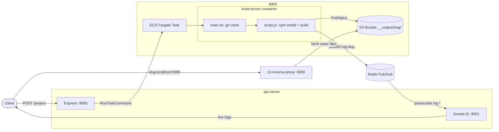

# deployement

A minimal Vercel-style deployment platform. Submit a GitHub repository URL, and the project is cloned, built in an isolated container on AWS ECS, uploaded to S3, and served on its own subdomain. Build logs are streamed live to the client.

## Architecture



## Flow

1. The client sends `POST /project` with `{ "github": "<repo url>" }`.
2. `api-server` generates a random slug and starts an ECS Fargate task running the `build-server` image, passing the repo URL, slug, and AWS credentials as environment variables.
3. The container clones the repo, installs dependencies, and runs `npm run build`.
4. The build output is uploaded to `s3://<bucket>/__output/<slug>/`.
5. Each log line is published to the Redis channel `log:<slug>`. `api-server` relays it to Socket.IO clients subscribed to that channel.
6. `s3-reverse-proxy` maps `<slug>.localhost:8000` to the matching S3 prefix and serves the site.

## Folders

### api-server

Entry point for deployments.

- `POST /project` starts a build task on ECS and returns the slug and preview URL.
- Runs a Socket.IO server on port `9001`. Clients emit `subscribe` with `log:<slug>` to receive build logs.
- Subscribes to Redis and forwards log messages to the matching Socket.IO room.

### build-server

Docker image that runs as the ECS task.

- `Dockerfile`: Ubuntu with Node.js 20 and git.
- `main.sh`: clones `GIT_REPOSITORY_URL` into `/home/app/output`, then runs `script.js`.
- `script.js`: builds the project, finds the output directory (`dist`, `build`, `out`, or `.next`), uploads every file to S3 with the correct content type, and publishes progress to Redis. For Next.js builds, it also maps static assets to `_next/` and the generated `index.html` to the root.

### s3-reverse-proxy

Serves deployed sites on port `8000`.

- Reads the subdomain from the request hostname and proxies to `<S3 base>/__output/<subdomain>`.
- Rewrites `/` to `/index.html`.

## Environment Variables

See `.env.example`.

| Variable | Used by | Purpose |
|---|---|---|
| `AWS_REGION`, `AWS_ACCESS_KEY_ID`, `AWS_SECRET_ACCESS_KEY` | api-server, build-server | AWS access |
| `CLUSTER`, `TASK` | api-server | ECS cluster and task definition |
| `BUCKET_NAME` | build-server | S3 bucket for build output |
| `GIT_REPOSITORY_URL`, `PROJECT_ID` | build-server | Set per task by api-server |
| `REDIS_URL`, `REDIS_TOKEN` | api-server, build-server | Redis connection for logs |

## Running Locally

```bash
cd api-server && npm install && node index.js
cd s3-reverse-proxy && npm install && node index.js
```

Build and push the `build-server` image to ECR, then register it as the ECS task definition referenced by `TASK`.
